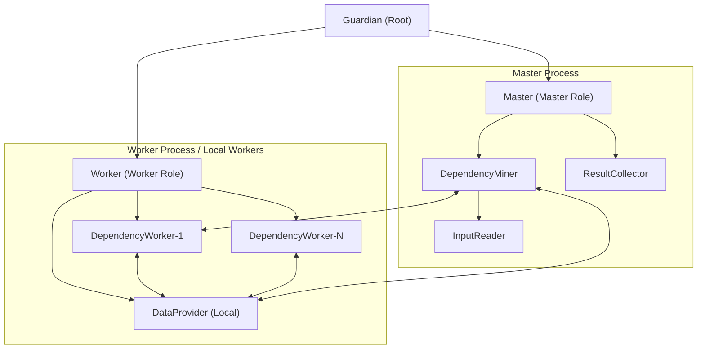
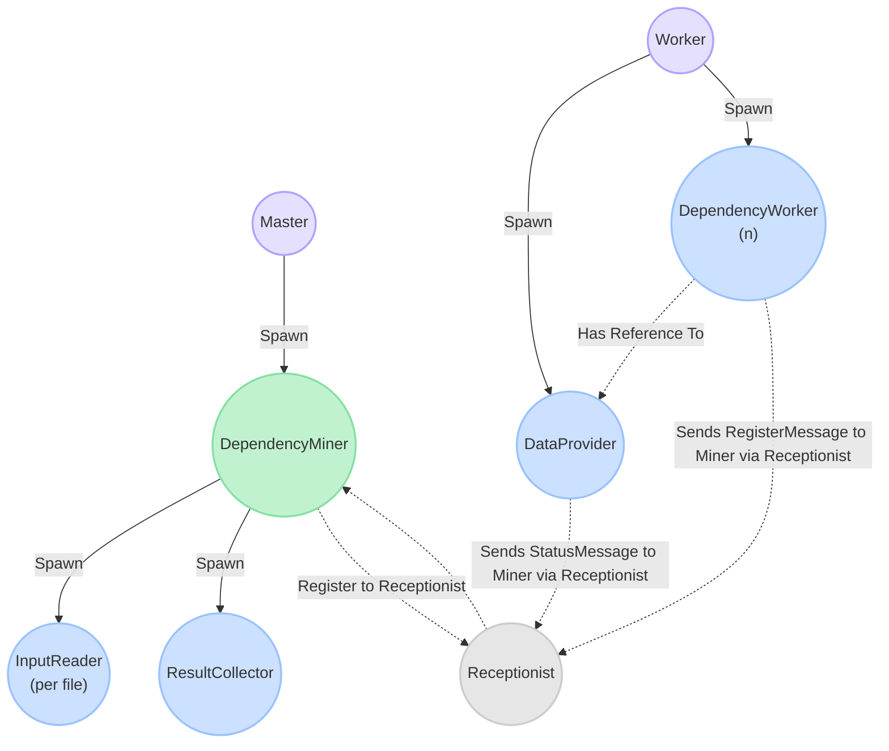
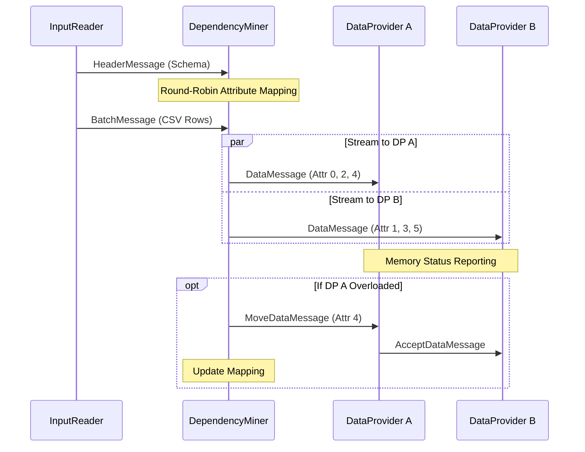
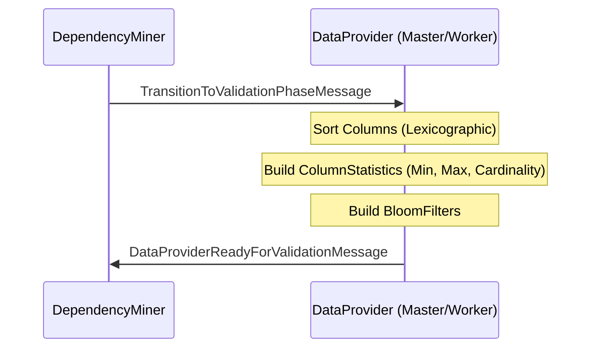
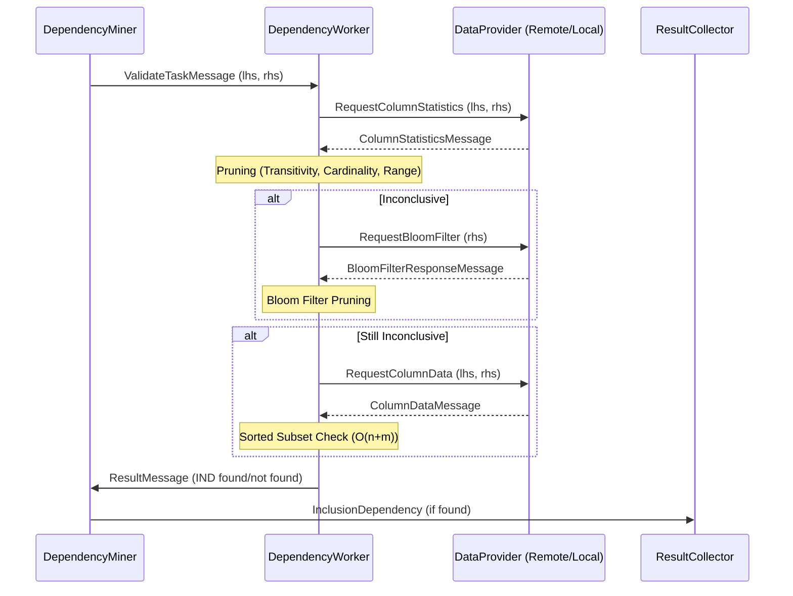

# Project Documentation: ddm-akka

This document provides a comprehensive overview of the `ddm-akka` project, covering its architecture, message flows, core logic, and key features.

## Table of Contents

1. [Architecture Overview](#architecture-overview)
2. [Application Flow & Messages](#application-flow--messages)
    - [Phase 1: Cluster Discovery & Actor Recruitment](#phase-1-cluster-discovery--actor-recruitment)
    - [Phase 2: Data Distribution (Loading Phase)](#phase-2-data-distribution-loading-phase)
    - [Phase 3: Transition Phase](#phase-3-transition-phase)
    - [Phase 4: Validation Phase](#phase-4-validation-phase)
3. [Important Logic & Decisions](#important-logic--decisions)
4. [Completed Work & Features](#completed-work--features)
5. [Summary of Performance Optimizations](#summary-of-performance-optimizations)

---

## Architecture Overview

The project is built on the **Akka Typed** actor framework, designed for distributed unary Inclusion Dependency (IND) discovery. It uses a master-worker architecture where the workload is distributed across multiple nodes (JVM processes).

### Actor Hierarchy

> `DataProvider` and `DependencyWorker`s are only spawned if the number of local workers (`-w`) is greater than 0. Each worker node (or the master if `-w > 0`) maintains exactly one `DataProvider` that serves all local `DependencyWorker`s.

---

## Application Flow & Messages

The discovery process is divided into several distinct phases, each with specific actor interactions.

### Phase 1: Cluster Discovery & Actor Recruitment

The system uses a dynamic discovery mechanism via the Akka Receptionist to coordinate between the Master and Worker nodes.

1. **Actor Startup**:
    - The **Master** node role spawns the `DependencyMiner`.
    - `DependencyMiner` immediately spawns the `InputReader`s and the `ResultCollector`.
    - The **Worker** node role spawns one `DataProvider` and multiple `DependencyWorker`s (if `-w > 0`).
2. **Discovery**:
    - `DependencyMiner` registers itself with the `Receptionist`.
    - `DataProvider` and `DependencyWorker` use the `Receptionist` to find and communicate with the `DependencyMiner`.
3. **Registration**:
    - Workers send their registration and status messages to the Miner to join the cluster's active resource pool.

### Phase 2: Data Distribution (Loading Phase)

The `DependencyMiner` coordinates the movement of data from the source files to the distributed `DataProvider` memory.

### Phase 3: Transition Phase

Once all data is loaded, the system prepares for validation by sorting data and building probabilistic filters.

### Phase 4: Validation Phase

The core discovery logic where attribute pairs are checked for inclusion dependencies using multiple pruning layers.

---

## Important Logic & Decisions

### Pruning Strategies

To minimize expensive data transfers and comparisons, the system employs several pruning layers:

1. **Transitivity Pruning**: If we know $A \subseteq B$ and $B \subseteq C$, then $A \subseteq C$ is inferred and the validation task is skipped.
2. **Cardinality Pruning**: If $|A| > |B|$, then $A \not\subseteq B$.
3. **Range Pruning**: If $\min(A) < \min(B)$ or $\max(A) > \max(B)$, then $A \not\subseteq B$.
4. **Bloom Filter Pruning**: A probabilistic check using RHS Bloom filter to see if elements of $A$ are present in $B$. If an element is definitely missing, the IND is rejected.

### Memory-Efficient Data Structures

- **Sorted Columns**: Storing columns as sorted `ArrayList<String>` allows for efficient subset checks in $O(n+m)$ time.

- **BloomFilter**: A custom implementation using `BitSet` and MurmurHash3-style mixing, optimized for low memory footprint on Raspberry Pi clusters.
- **Serialization**: Uses `long[]` for `BloomFilter` bitsets to ensure reliable Jackson/CBOR serialization across the cluster.

---

## Completed Work & Features

- [x] **Distributed Akka Cluster**: Support for multi-process and multi-machine execution.
- [x] **Decentralized Data Providers**: Scalable data management across the cluster.
- [x] **Resource-Aware Load Balancing**: Dynamic redistribution of data based on memory pressure.
- [x] **Advanced Pruning**: Multi-layered pruning including Transitivity and Bloom filters.
- [x] **LHS Data Caching**: `DependencyWorker` caches the most recently used LHS column to speed up batch validations.
- [x] **Large Message Support**: Seamless transfer of large datasets via proxy pattern.
- [x] **Custom Bloom Filter**: Memory-optimized implementation with adjustable false-positive rates.

## Summary of Performance Optimizations

| Optimization | Impact | Description |
| :--- | :--- | :--- |
| **Sorted Subset Check** | High | Reduces comparison complexity from quadratic to linear. |
| **Transitivity** | High | Eliminates a large portion of validation tasks as the "known" IND set grows. |
| **Bloom Filters** | Medium-High | Prevents full column data transfer for many negative cases. |
| **Memory Monitoring** | High | Prevents JVM crashes on memory-constrained nodes (e.g., Pi cluster). |
| **LHS Caching** | Medium | Speeds up validation when multiple RHS attributes are checked against the same LHS. |

---
